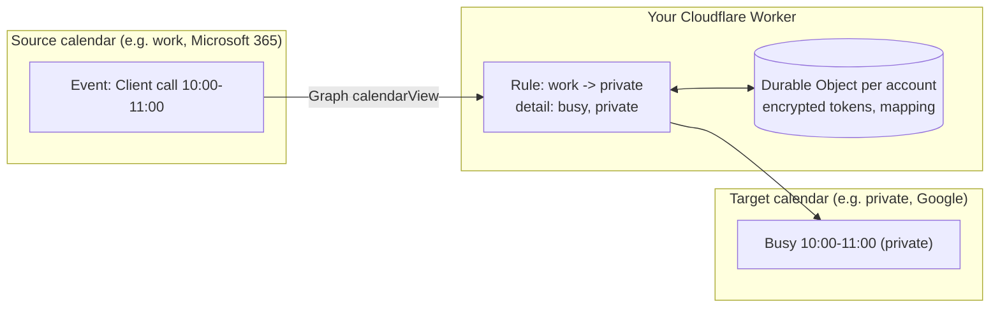

<p align="center"></p>

# freebusy-sync

Mirror busy blocks between Microsoft 365 and Google calendars. Self-hosted on Cloudflare Workers,
runs on the Workers Free plan.

> **Status: early development.** Sign-in, connecting Microsoft 365 accounts, users and roles
> work. The sync itself is in progress; do not use this for real calendars yet.

## What it does

If you work in more than one calendar (two Microsoft 365 tenants, a work and a private Google
account, or a mix), colleagues only see the calendar they share a tenant with. freebusy-sync reads
your events in one calendar and writes matching blocks into the others.

- **You choose the detail per direction.** Work events can arrive in your private calendar with
  title and location, while private events arrive in your work calendar only as "Busy", marked
  private. The default is "Busy" only.
- **Recurring events are exact.** Every occurrence of a series is mirrored on its own, so a moved
  or cancelled single occurrence moves or removes its block.
- **Every run compares the full window.** freebusy-sync checks what each target calendar should
  contain and fixes any difference, instead of trusting that it saw every change. Only differences
  are written; blocks are never rebuilt.
- **You can see what happened.** The status shows numbers, not just "success", and an audit log
  records every block it created, moved or deleted, without event content.
- **You run your own copy** in your own Cloudflare account, on the Free plan. Nobody else holds your
  tokens. One deployment serves one person or a whole team.



## Deploy

<!-- The button URL needs the public repository URL. -->

Requirements:

- A Cloudflare account. The Free plan is enough.
- For Microsoft 365: an app registration in Microsoft Entra ID (steps below).
- For Google Calendar: an OAuth client in Google Cloud (steps below).

### Settings

One deployment serves one person or one team. Each user signs in, connects their own calendars
and sets their own rules. Nobody sees another user's calendars.

| Name                              | Kind     | Purpose                                                                                    |
| --------------------------------- | -------- | ------------------------------------------------------------------------------------------ |
| `ALLOWED_EMAILS`                  | variable | Comma-separated addresses that may sign in. For a personal deployment, your own address.   |
| `ALLOWED_DOMAINS`                 | variable | Comma-separated email domains whose users may sign in, e.g. `example.com`. For a team.     |
| `ALLOWED_TENANT_IDS`              | variable | Optional. Entra tenant IDs; Microsoft sign-ins from other tenants are refused.             |
| `ADMIN_EMAILS`                    | variable | Addresses with access to the admin page (users and account counts, no calendar data).      |
| `ORG_NAME`                        | variable | Optional display name.                                                                     |
| `TIME_ZONE`                       | variable | IANA time zone for dates in the dashboard, e.g. `Europe/Vienna`. Default `UTC`.            |
| `PRIVACY_CONTACT`                 | variable | Address shown on the `/privacy` page as the operator's contact.                            |
| `SIGN_IN_PROVIDERS`               | variable | Optional. `microsoft`, `google` or both. Limits sign-in; connecting accounts stays open.   |
| `DATA_JURISDICTION`               | variable | Optional. `eu` keeps the Durable Objects in the EU. Set before the first account connects. |
| `MAX_DETAIL_TO_EXTERNAL`          | variable | Optional cap from org accounts to other accounts: `busy`, `title`, `title_location`.       |
| `MAX_DETAIL_FROM_EXTERNAL`        | variable | Optional cap from other accounts to org accounts. Same values.                             |
| `SESSION_SECRET`                  | secret   | At least 32 characters. Signs the session cookie. `openssl rand -base64 48`                |
| `TOKEN_ENCRYPTION_KEY`            | secret   | Base64-encoded 32-byte key for AES-GCM token encryption. `openssl rand -base64 32`         |
| `MICROSOFT_CLIENT_ID` / `_SECRET` | secret   | Entra app registration. Leave empty if you do not use Microsoft 365.                       |
| `GOOGLE_CLIENT_ID` / `_SECRET`    | secret   | Google OAuth client. Leave empty if you do not use Google Calendar.                        |

If you remove someone from these settings, their access ends at their next request.

**Org accounts** are accounts whose Entra tenant is in `ALLOWED_TENANT_IDS` or whose domain is in
`ALLOWED_DOMAINS`. The detail caps apply between them and every other account, at every run. A
lower cap also rewrites the blocks a rule already wrote. An invalid cap value counts as `busy`.

**For a team on Microsoft 365**, set `ALLOWED_DOMAINS` to your domain, `ALLOWED_TENANT_IDS` to
your tenant and `SIGN_IN_PROVIDERS=microsoft`. Only then is sign-in limited to your Entra
tenant: anyone can create a Google account on an address at your domain.

**Data location.** With `DATA_JURISDICTION=eu`, tokens and the sync itself, which reads event
contents, stay in the EU. Create the D1 database in the EU too:
`wrangler d1 create freebusy-sync --jurisdiction=eu`. Neither setting can change for existing
data. Changing `DATA_JURISDICTION` later disconnects every account.

Until all required settings are present, every dashboard page shows a setup checklist. The
checklist names missing settings and never shows values.

### Microsoft Entra app registration

_To be written._ It needs a web redirect URI on your Worker domain and the delegated permissions
`Calendars.ReadWrite`, `User.Read` and `offline_access`.

### Google OAuth client

_To be written._ Set the OAuth consent screen to **In production**. In **Testing**, Google
expires refresh tokens after 7 days.

## Free plan limits

The Workers Free plan allows 10 ms CPU time and 50 subrequests per invocation. freebusy-sync
splits each sync into one step per rule direction, so that a step stays inside these limits.
The daily quotas (100,000 Worker requests, 100,000 Durable Object requests) cover a person or a
small team. Each connected account needs a few hundred requests a day, so a large team needs
Workers Paid ($5/month).

## Provider rate limits

Microsoft and Google throttle a client that sends too many requests. freebusy-sync stays inside
their limits and recovers when it is throttled.

- **Outlook** allows four concurrent requests per app and mailbox, and 10,000 requests in 10
  minutes. One `$batch` already uses the four slots. All calls to a mailbox start in the
  Durable Object of its account, and that instance runs them one at a time.
- **Google** allows 600 requests per minute per user. Each call in a batch counts as one
  request.
- **If a provider throttles**, the throttled writes stay open and the next alarm waits for
  `Retry-After`. Graph answers 429 or 503. Google answers 429, or 403 with the reason
  `rateLimitExceeded` or `userRateLimitExceeded`, and sends no `Retry-After`. Without the header,
  the wait is 30 seconds.
- **The activity log** shows the HTTP status and the provider's error code of each failed or
  throttled write, for example `HTTP 429 ApplicationThrottled ×13`.

## Development

```sh
pnpm install
cp .dev.vars.example .dev.vars   # fill in the values
pnpm db:migrate:local
pnpm dev
```

| Command           | Purpose                                                                |
| ----------------- | ---------------------------------------------------------------------- |
| `pnpm test`       | Vitest inside the Workers runtime (`@cloudflare/vitest-plugin`)        |
| `pnpm typecheck`  | TypeScript 7                                                           |
| `pnpm lint`       | oxlint with type-aware rules                                           |
| `pnpm format`     | oxfmt                                                                  |
| `pnpm check`      | all of the above                                                       |
| `pnpm cf-typegen` | regenerate `worker-configuration.d.ts` after changing `wrangler.jsonc` |

### Architecture

- **Worker (Hono):** dashboard pages rendered with Hono JSX, OAuth callbacks, webhook endpoints,
  cron trigger.
- **D1:** orgs, users, accounts, calendars, rules and sync runs (`migrations/`). A self-hosted
  deployment has one org; its access policy follows the variables above.
- **Durable Object `AccountSync`, one per connected account:** encrypted tokens, webhook
  subscriptions and the queue of rules to run. A rule runs in the instance of its target account
  and reads busy times from the source account's instance. Each block carries a marker with the
  rule and the source occurrence, so the target calendar itself records which blocks exist. No
  mapping table can drift.

## Contributing and security

- [CONTRIBUTING.md](CONTRIBUTING.md) explains the setup, commit format and pull requests.
- [AGENTS.md](AGENTS.md) holds the project rules for AI coding agents.
- Report vulnerabilities privately, see [SECURITY.md](SECURITY.md).

## License

[MIT](LICENSE)
