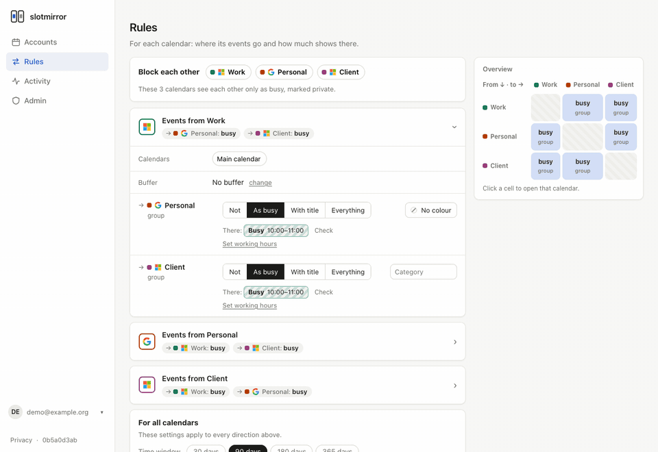
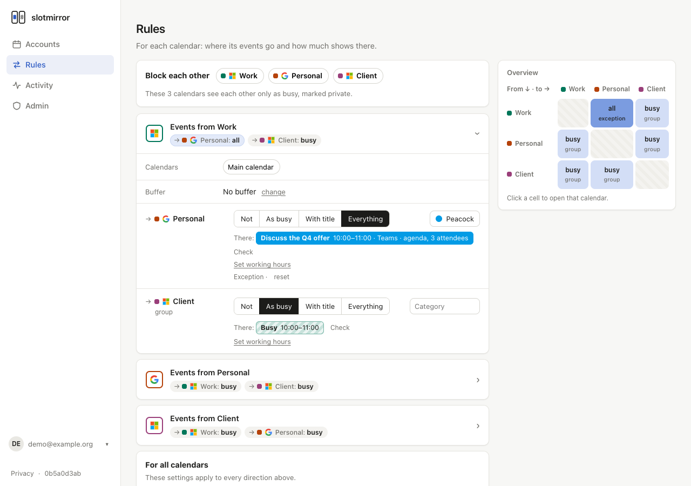
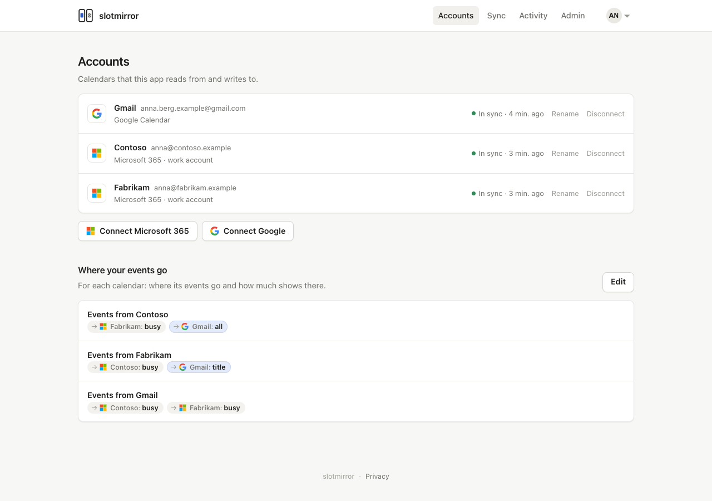
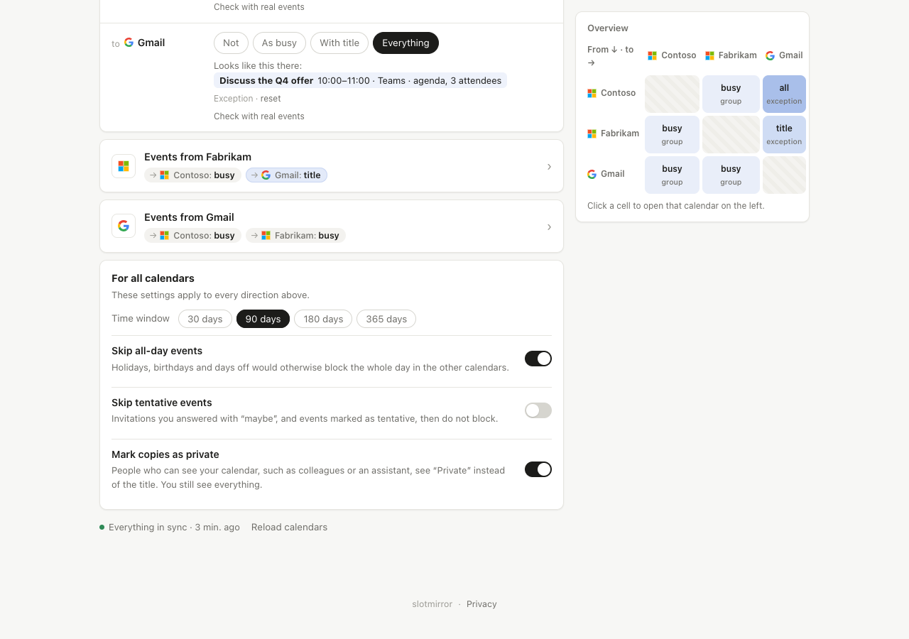
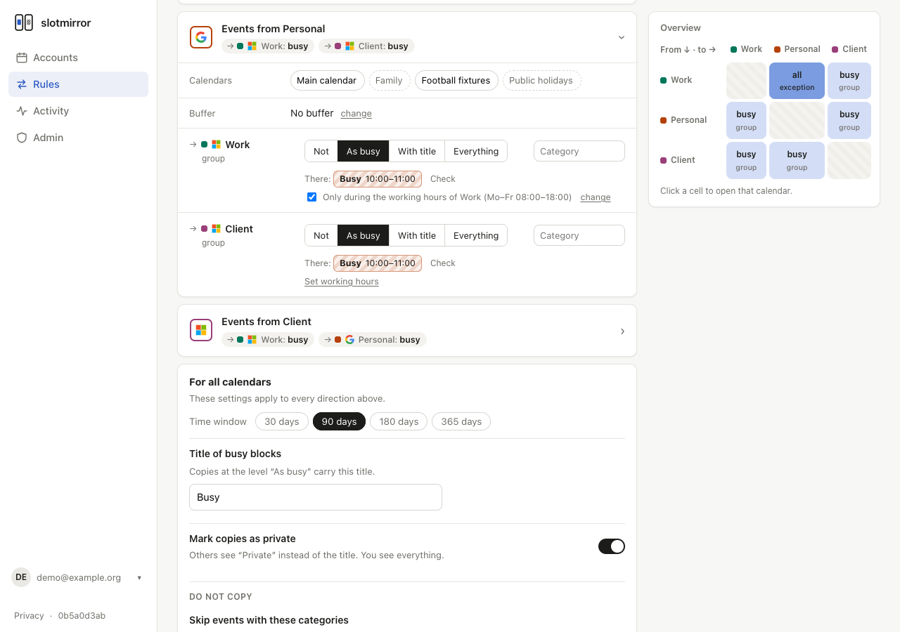
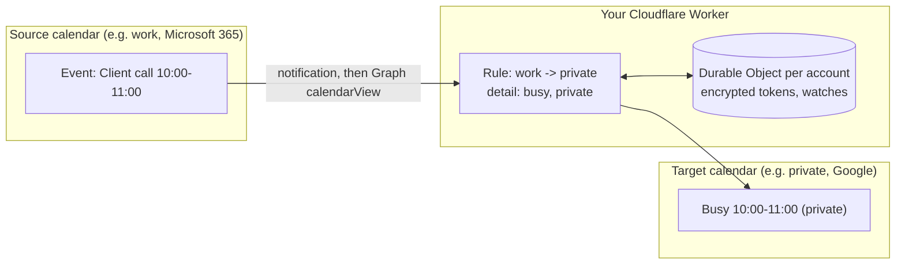

<h1 align="center">
  <picture>
    <source media="(prefers-color-scheme: dark)" srcset="design/logo/lockup-dark-bg.svg">
    
  </picture>
</h1>

<p align="center">
  <a href="https://buymeacoffee.com/michaeljauk">
    
  </a>
</p>

<p align="center">
  <a href="https://github.com/michaeljauk/slotmirror/actions/workflows/ci.yml"></a>
  <a href="https://github.com/michaeljauk/slotmirror/actions/workflows/codeql.yml"></a>
  <a href="LICENSE"></a>
</p>

<p align="center">
  
</p>

Keep several calendars in sync, so that nobody books you twice. slotmirror copies your events
from one calendar into your others as "Busy" blocks, or with as much detail as you choose. It
supports Microsoft 365 and Google Calendar and runs in your own Cloudflare account, on the free
plan.

It is for people with more than one calendar: consultants with client tenants, founders with two
companies, anyone with a work and a private calendar. You host it yourself, so your calendar
tokens stay with you and not with a sync service.

> **Status: early.** The author uses it every day for three calendars. The version is below 1.0,
> so settings and the database can still change between releases.



## What it does

- **One group for the common case.** Put your calendars in the block group, and each sees the
  others only as "Busy", marked private.
- **More detail where you want it.** Per calendar and target you choose: not at all, as busy,
  with title, or everything. An example event shows the result before you save.
- **Working hours.** Each account can have working hours: chosen weekdays and a time range, for
  example Monday to Friday, 08:00 to 18:00, Europe/Vienna. You set them in the account settings. Per
  calendar and target you can then mirror only the events inside the working hours of the target
  account. An event is mirrored if it overlaps the range on one chosen day. Its block keeps the
  event's real times; it is never cut to the range. An all-day event counts if one of its dates is a
  chosen weekday. The end must be after the start; "until midnight" ends the range at the end of the
  day, and a range over midnight is not possible. An account has no working hours until you set
  them; the time zone field starts with the browser's zone, or the deployment's `TIME_ZONE` without
  JavaScript. Turning them on or off does not change whether a direction in the block group is an
  exception; the reset turns them off. On the two days a year when clocks change, a range that spans
  the change is one hour shorter or longer in real time. A start or end in the skipped hour moves
  forward by an hour; one in the repeated hour means its first occurrence, for the start and the end
  alike. A range that ends at 02:30 on the night clocks go back therefore ends an hour before the
  second 02:30.
- **A colour for the blocks.** Per calendar and target you can colour the blocks: a Google event
  colour, or an Outlook category. Outlook shows the category's colour if the category exists in
  that mailbox; create it in Outlook first.
- **A buffer around the blocks.** Per source calendar account, blocks can start up to 240 minutes
  earlier and end up to 240 minutes later than the event, for example for travel time. The buffer
  applies to every target of that account. The account keeps it while it has no targets, and new
  directions and group rules from it take it. The default is 0. All-day events get no buffer. Where
  buffered blocks overlap, each event keeps its own block. If one event reaches a calendar through
  two directions with the same buffer, it gets one block. With different buffers it can get two, so
  that the wider buffer is never lost.
- **A colour per account.** Each account gets its own colour in the pages, automatically or
  chosen under "Settings". It does not change any calendar.
- **Origin note.** A rule can name the source account in each block's description, for example
  "From: Work (Microsoft)", and add a link to the source event. An account without a name shows
  as "Microsoft account" or "Google account", never with its address. The link needs detail level
  "title" or more, and a private event never gets one. Where a detail cap below "full" applies
  between the two accounts, neither note nor link is written, even if the rule asks for no more
  than the cap. The link is the one exception to "no source ID leaves the
  source": it holds the provider's event ID, and Google's link also encodes the calendar ID, which
  for a main calendar is the account's address. The settings for this come with the new editor.
- **Several calendars per account.** Next to the main calendar you can add others, such as a
  subscribed team schedule. Targets are always the main calendars.
- **Changes within seconds.** Microsoft and Google notify your deployment when a calendar
  changes. A full sync every hour catches anything a notification missed.
- **Recurring events are exact.** Each occurrence is mirrored on its own, so a moved or
  cancelled single occurrence moves or removes its block.
- **Only differences are written.** Every run compares what each target should contain with what
  it does contain. Blocks are never rebuilt.
- **Privacy limits for teams.** An admin can cap how much moves between work calendars and
  private ones, for example at most "busy" from private to work.
- **EU data location.** Tokens and the sync itself can stay in the EU.
- **Audit log.** Sign-ins, changes and sync runs with counts and error codes, never event content.
- **Free/busy feed.** A secret ICS address per feed that shows your busy times to people
  outside the deployment, without titles or other content.
- **English and German.**

## Quickstart

The full quickstart is in the [documentation](https://slotmirror.com/docs/quickstart/). It takes
about 30 minutes with one provider. The order is: deploy, read the address of your Worker, create
the OAuth app, set the secrets.

[](https://deploy.workers.cloudflare.com/?url=https://github.com/michaeljauk/slotmirror)

Before you click, read the quickstart: the button asks for `SESSION_SECRET` and
`TOKEN_ENCRYPTION_KEY`, and the quickstart shows how to generate them. Leave the provider fields
empty. Until you set `ALLOWED_EMAILS` and `ADMIN_EMAILS` as variables in the Cloudflare dashboard,
every page shows a checklist of what is missing.

To deploy by hand, see [Deploy by hand](https://slotmirror.com/docs/quickstart/#deploy-by-hand).

To update a running deployment, see
[Updating your deployment](https://slotmirror.com/docs/updating/).

`pnpm run deploy` also passes the short commit hash to the build, and the app footer shows it. A
deploy with plain `wrangler deploy` has no hash; the footer then shows only a release version, if
the build has one.

## Screens

| Accounts                                        | Settings for all calendars                 |
| ----------------------------------------------- | ------------------------------------------ |
|  |  |



## Settings

One deployment serves one person or one team. Each user signs in, connects their own calendars
and makes their own choices. Nobody sees another user's calendars.

Set variables in the Cloudflare dashboard (Worker, Settings, Variables and Secrets), or in `.dev.vars`
locally. `wrangler.jsonc` does not list them and sets `keep_vars`, so a deploy keeps your values. A
`vars` entry in that file would replace the dashboard value on every deploy.

| Name                              | Kind     | Purpose                                                                                    |
| --------------------------------- | -------- | ------------------------------------------------------------------------------------------ |
| `ALLOWED_EMAILS`                  | variable | Comma-separated addresses that may sign in. For a personal deployment, your own address.   |
| `ALLOWED_DOMAINS`                 | variable | Comma-separated email domains whose users may sign in, e.g. `example.com`. For a team.     |
| `ALLOWED_TENANT_IDS`              | variable | Optional. Entra tenant IDs; Microsoft sign-ins from other tenants are refused.             |
| `ADMIN_EMAILS`                    | variable | Addresses with access to the admin page (users and account counts, no calendar data).      |
| `ORG_NAME`                        | variable | Optional display name.                                                                     |
| `TIME_ZONE`                       | variable | IANA time zone for dashboard dates and working hours, e.g. `Europe/Vienna`. Default `UTC`. |
| `PRIVACY_CONTACT`                 | variable | Address shown on the `/privacy` page as the operator's contact.                            |
| `SIGN_IN_PROVIDERS`               | variable | Optional. `microsoft`, `google` or `microsoft,google`. Limits sign-in; accounts stay open. |
| `PUBLIC_URL`                      | variable | Optional. The https address of this deployment. Turns on push notifications.               |
| `DATA_JURISDICTION`               | variable | Optional. `eu` keeps the Durable Objects in the EU. Set before the first account connects. |
| `MAX_DETAIL_TO_EXTERNAL`          | variable | Optional cap from org accounts to other accounts: `busy`, `title`, `title_location`.       |
| `MAX_DETAIL_FROM_EXTERNAL`        | variable | Optional cap from other accounts to org accounts. Same values.                             |
| `SESSION_SECRET`                  | secret   | At least 32 characters. Signs the session cookie. `openssl rand -base64 48`                |
| `TOKEN_ENCRYPTION_KEY`            | secret   | Base64-encoded 32-byte key for AES-GCM token encryption. `openssl rand -base64 32`         |
| `MICROSOFT_CLIENT_ID` / `_SECRET` | secret   | Entra app registration. Leave empty if you do not use Microsoft 365.                       |
| `GOOGLE_CLIENT_ID` / `_SECRET`    | secret   | Google OAuth client. Leave empty if you do not use Google Calendar.                        |
| `SCIM_TOKEN`                      | secret   | Optional. Bearer token for user provisioning from Entra over SCIM.                         |
| `ALERT_WEBHOOK_URL`               | secret   | Optional. Incoming webhook that hears when an account needs reconnecting. See below.       |

If you remove someone from these settings, their access ends at their next request. Sessions last 12
hours; signing in again is one click with the provider.

**Org accounts** are accounts whose Entra tenant is in `ALLOWED_TENANT_IDS` or whose domain is in
`ALLOWED_DOMAINS`. The detail caps apply between them and every other account, at every run. A
lower cap also rewrites the blocks a rule already wrote. An invalid cap value counts as `busy`.

**For a team on Microsoft 365**, set `ALLOWED_DOMAINS` to your domain, `ALLOWED_TENANT_IDS` to
your tenant and `SIGN_IN_PROVIDERS=microsoft`. Only then is sign-in limited to your Entra
tenant: anyone can create a Google account on an address at your domain.

**Data location.** With `DATA_JURISDICTION=eu`, tokens and the sync itself, which reads event
contents, stay in the EU. Create the D1 database in the EU too:
`wrangler d1 create slotmirror --jurisdiction=eu`. Neither setting can change for existing
data. Changing `DATA_JURISDICTION` later disconnects every account.

### Microsoft Entra app registration

1. In the Microsoft Entra admin center, open **App registrations** and choose **New
   registration**.
2. Supported account types: **Accounts in any organizational directory and personal Microsoft
   accounts**. Choose a single tenant only if every calendar is in your tenant.
3. Redirect URI: platform **Web**, `https://<your-worker>/auth/microsoft/callback`.
4. Under **API permissions**, add the delegated Microsoft Graph permissions `openid`, `email`,
   `profile`, `offline_access`, `User.Read` and `Calendars.ReadWrite`. Users can consent to these
   themselves unless your tenant blocks user consent.
5. Under **Certificates & secrets**, create a client secret. Note when it expires; the sync stops
   when it does.
6. Set `MICROSOFT_CLIENT_ID` (the application ID) and `MICROSOFT_CLIENT_SECRET`.

### Google OAuth client

1. In the Google Cloud console, create a project and enable the **Google Calendar API**.
2. In **Google Auth Platform**, fill in **Branding**: app name, your Worker's address as home
   page, `https://<your-worker>/privacy` as privacy policy, and your Worker's domain as authorized
   domain.
3. Under **Data access**, add the scopes `openid`, `email`, `profile`,
   `https://www.googleapis.com/auth/calendar.events` and
   `https://www.googleapis.com/auth/calendar.calendarlist.readonly`.
4. Under **Audience**, publish the app to **In production**. In **Testing**, Google expires
   refresh tokens after 7 days. Until Google verifies the app, users see a warning that the app
   is not verified; for your own deployment you can continue past it.
5. Under **Clients**, create a **Web application** client with the redirect URI
   `https://<your-worker>/auth/google/callback`.
6. Set `GOOGLE_CLIENT_ID` and `GOOGLE_CLIENT_SECRET`.

## Users joining and leaving

Each user can delete their own data under **Delete my data** in the account menu. Admins can
delete other users on the admin page. Both remove the user's accounts with their tokens, their
rules, and the blocks those rules wrote from today on. Past blocks stay in the calendars, and
activity entries stay until the retention period ends.

A disconnected account keeps its encrypted tokens until the blocks in its own calendars are
removed. Its next alarm stops its watches. A watch that cannot be stopped is tried again when the
tokens are deleted, or expires within days; its notifications are ignored. The account reads its calendars only to find and delete those blocks.
If the provider keeps failing, the removal tries again after 1 minute, 10 minutes, 2 hours and
12 hours. After the fifth failed attempt, or at once if the provider refuses the tokens, the tokens
are deleted and the remaining blocks stay.

For a team on Microsoft 365, Entra can manage users over SCIM 2.0: it creates them before their
first sign-in, deactivates them when they leave, and deletes them. A deactivated user cannot sign
in, and any open session ends at the next request. Their rules stop and their blocks are removed;
accounts and rules stay, so a reactivation syncs again.

To set it up:

1. Set a long random secret: `wrangler secret put SCIM_TOKEN` (for example from
   `openssl rand -base64 48`). Without it, `/scim/v2` does not exist.
2. In the Entra admin center, create an enterprise application ("Create your own application",
   "Integrate any other application you don't find in the gallery").
3. Under **Provisioning**, choose "Automatic", set the tenant URL to
   `https://<your deployment>/scim/v2` and the secret token to `SCIM_TOKEN`, and test the
   connection.
4. Under **Attribute mapping**, keep the users mapping and turn off groups. slotmirror stores
   `userName` (the sign-in address), `externalId` and `active`, and ignores the rest.
5. Assign the users or groups who should use slotmirror, then start provisioning.

## Push notifications

With `PUBLIC_URL` set, slotmirror asks Microsoft and Google to notify it when a calendar that a
rule reads or writes changes. A change then syncs within seconds. Microsoft subscriptions last up
to 7 days and Google channels until Google ends them; the cron renews both a day before they
expire. Every 10 minutes the cron also syncs calendars without an active subscription. Once an
hour it syncs every rule, so a missed notification costs at most one hour.

A notification about blocks slotmirror just wrote starts no sync. Microsoft names the changed
events in the notification. Google does not, so slotmirror reads the calendar's change feed, which
returns only event IDs, and compares them with its own recent writes.

Each notification carries a token that only your deployment can compute, an HMAC of the account
with `SESSION_SECRET`. Notifications without it change nothing. If you rotate `SESSION_SECRET`, the
existing subscriptions no longer match until they expire and are created again, which can take up
to 7 days. In the meantime the hourly full sync keeps the blocks current.

## When an account needs reconnecting

A provider can refuse an account's refresh token for good. Examples: the user revoked access, an
admin ended the sessions, or Google's testing mode ended the token after 7 days. slotmirror then
marks the account and stops its work until the user connects it again:

- The accounts page shows a notice at the top. It names the account's address and provider and
  has a **Reconnect** button. The button starts the provider's sign-in with that address
  preselected. The account's row shows the same state, and the sync page shows the notice too.
- The admin page lists which users have accounts that need reconnecting, without the addresses.
- The activity log records "Token refresh failed", with the provider's error code.
- The account asks the provider nothing more. Rules into its calendars pause, and rules that read
  from it wait.
- Once a day, slotmirror tries the refused token again. Some refusals end by themselves, for
  example when an admin enables a disabled user again. If the provider accepts the token, the
  mark goes and a full sync starts. A refused try adds one more "Token refresh failed" entry.
- An account that an older version marked tries its token at the next cron tick, without an
  alert.
- When the user connects the same account again, the mark goes and a full sync starts.

**Alerts.** If you set the secret `ALERT_WEBHOOK_URL`, slotmirror posts `{"text": "..."}` to it
at most once each time an account changes to "needs reconnecting". The text names the provider and
`PUBLIC_URL`, never the account, the user or any event. This is the format of Slack incoming
webhooks; Google Chat and Mattermost accept it too. Microsoft Teams needs its own card format, so
use a Teams workflow that takes the `text` field. The URL must start with `https://`. A failed
post is logged without the URL and is not retried.

## Free/busy feed

Under **Free/busy feed** on the start page, each user can create a secret calendar address for
people outside the deployment. They subscribe to it by URL in their calendar app, for example with
"Add calendar from URL" in Google Calendar or "Subscribe from web" in Outlook.

**What it shares.** Busy blocks from up to five calendars, from 7 days ago to up to 180 days ahead
(60 by default). Overlapping and adjacent events form one block. Each block has only its start,
its end, the title "Busy" in your language, and the marks private and busy. Titles, places, notes,
attendees, organizers, source event IDs and the number of events in a block stay out. The same
events count as for a rule with default settings: free and declined events stay out, tentative
ones count as busy, and all-day events count only if you turn them on. Blocks that slotmirror
wrote are left out, so choose every calendar whose own events should count. Only calendars that
your accounts own can go into a feed, not calendars that other people shared with you. For
Google, these are the primary calendar and calendars whose data owner is the account; the access
role "owner" alone also covers calendars shared with "make changes and manage sharing". This rule
is for feeds only; which calendars a rule can write into does not change. After the update, a
secondary Google calendar becomes available for feeds once you refresh the calendar list. The UID
of a block is an HMAC of its start and end with a secret per feed, so a moved meeting is a new block,
and two feeds cannot be linked through their UIDs.

**At most 1000 blocks.** Above that, past blocks go first, those that ended earliest first. A
block that runs into today, such as an ongoing absence, stays. If the feed is still too long, it
ends early, and the start page says before which date. Choose fewer days or calendars.

**Who can see it.** Anyone with the address. The address holds a random 256-bit token;
slotmirror stores only its SHA-256 hash and shows the address once, when you create the feed or
renew it. The token is in the URL path, so it reaches every log that records request URLs; see
[Logs](#logs-and-the-feed-token).

**Renew or delete.** "New address" replaces the token: the old address returns 404 at once, and
everyone who should still see the feed needs the new one. "Delete" ends the feed. A feed also ends
when its last calendar goes with a disconnected account, when its user is deleted or deactivated,
and at its next fetch once the access settings no longer admit its user. A reactivated user
creates new feeds. If the access settings admit nobody at all, for example after a deploy with
empty `ALLOWED_*` values, the feeds stay and answer 503 until the settings are back.

**Delay.** A rendered feed is reused for 15 minutes. The last copy stays in D1 with the feed, so
a repeated fetch costs one D1 read and no calendar read; the Cache API also keeps it, but
Cloudflare documents a working cache only for custom domains. Calendar apps fetch subscribed
calendars on their own schedule, from every 15 minutes to once a day. A change can take that long
to appear.

**When a calendar cannot be read.** Subscribers never get a partial feed:

- While Microsoft or Google throttles the account, the feed serves its last copy, however old, and
  makes no provider call. Without a copy, it answers 503 with the remaining `Retry-After`.
- If an account needs to be connected again, the feed answers 503.
- If the provider no longer finds a calendar or refuses access to it, or the account no longer
  owns it, the feed answers 503, and the start page names the calendar with a button to remove it
  from the feed.
- Any other failed read also answers 503.

A failure is stored with the feed: for 15 minutes, fetches answer 503 from that one D1 read and
make no new read. Apps keep their last copy while the feed answers 503.

### Logs and the feed token

With `observability` on in `wrangler.jsonc`, Workers Logs record an invocation log for every
request, with its URL, so the feed token is stored in the operator's Cloudflare account. slotmirror
itself logs only feed IDs. An operator can turn the invocation logs off; `console` output is a
separate kind of log in Workers Logs:

```jsonc
"observability": { "enabled": true, "logs": { "invocation_logs": false } }
```

This drops the invocation logs of every request, not only of feeds. `wrangler tail` and the
dashboard's live logs still show URLs while they run. On a custom domain, other Cloudflare
products that log requests, such as Logpush, record the path too.

## Limits

- **Microsoft 365 and Google only.** iCloud and other CalDAV calendars are not supported yet.
- **Targets are main calendars.** Blocks go into each account's main calendar, not into other
  calendars of the account.
- **Past blocks stay.** The sync looks from today forward. When you delete a rule, its blocks
  from today on are removed; blocks before today stay as history.
- **Free plan quotas.** See below. A large team needs Workers Paid.
- **Unverified Google app.** Until you have Google verify your OAuth client, Google shows a
  warning when someone connects a Google account.

### Free plan limits

The Workers Free plan allows 10 ms CPU time and 50 subrequests per invocation. slotmirror
splits each sync into one step per rule direction, so that a step stays inside these limits.
The daily quotas (100,000 Worker requests, 100,000 Durable Object requests) cover a person or a
small team. Each connected account needs a few hundred requests a day, so a large team needs
Workers Paid ($5/month).

### Provider rate limits

Microsoft and Google throttle a client that sends too many requests. slotmirror stays inside
their limits and recovers when it is throttled.

- **Outlook** allows four concurrent requests per app and mailbox, and 10,000 requests in 10
  minutes. One `$batch` already uses the four slots. All calls to a mailbox start in the
  Durable Object of its account, and that instance runs them one at a time.
- **Google** allows 600 requests per minute per user. Each call in a batch counts as one
  request.
- **If a provider throttles**, the throttled writes stay open and the next alarm waits for
  `Retry-After`. Graph answers 429 or 503. Google answers 429, or 403 with the reason
  `rateLimitExceeded` or `userRateLimitExceeded`, and sends no `Retry-After`. Without the header,
  the wait is 30 seconds.
- **The activity log** shows the HTTP status and the provider's error code of each failed or
  throttled write, for example `HTTP 429 ApplicationThrottled ×13`.

## Development

```sh
pnpm install
cp .dev.vars.example .dev.vars   # fill in the values
pnpm db:migrate:local
pnpm dev
```

| Command           | Purpose                                                                |
| ----------------- | ---------------------------------------------------------------------- |
| `pnpm test`       | Vitest inside the Workers runtime (`@cloudflare/vitest-plugin`)        |
| `pnpm typecheck`  | TypeScript 7                                                           |
| `pnpm lint`       | oxlint with type-aware rules                                           |
| `pnpm format`     | oxfmt                                                                  |
| `pnpm check`      | all of the above                                                       |
| `pnpm cf-typegen` | regenerate `worker-configuration.d.ts` after changing `wrangler.jsonc` |

### Load tests with simulated calendars

`wrangler dev --var DEV_FAKE_CALENDARS:1 --var DEV_FAKE_LATENCY_MS:80` replaces Graph and Google
with simulated calendars inside the Durable Objects. Signed in as an admin, `POST /dev/seed?accounts=10&events=200`
creates ten accounts in the block group, `POST /dev/cycle` starts a sync cycle, and `GET /dev/stats`
counts runs, writes and provider calls. Without the variable the `/dev` routes do not exist.

### Architecture



- **Worker (Hono):** dashboard pages rendered with Hono JSX, OAuth callbacks, webhook endpoints,
  cron trigger.
- **D1:** orgs, users, accounts, calendars, rules and the audit log (`migrations/`). A
  self-hosted deployment has one org; its access policy follows the variables above.
- **Durable Object `AccountSync`, one per connected account:** encrypted tokens, the provider
  watches and the queue of rules to run. A rule runs in the instance of its target account and
  reads events from the source account's instance. Each block carries a marker with the rule and
  the source occurrence, so the target calendar itself records which blocks exist. No mapping
  table can drift. If several rules would write equal blocks (same times, same title) into one
  calendar, for example from two calendars that both hold a match, only one block is written.

## Contributing and security

- [CONTRIBUTING.md](CONTRIBUTING.md) explains the setup, commit format and pull requests.
- [AGENTS.md](AGENTS.md) holds the project rules for AI coding agents.
- Report vulnerabilities privately, see [SECURITY.md](SECURITY.md).

## Support

Built by [Michael Jauk](https://github.com/michaeljauk). If this saves you time, consider
[buying me a coffee](https://buymeacoffee.com/michaeljauk).

## License

[MIT](./LICENSE) © Michael Jauk
